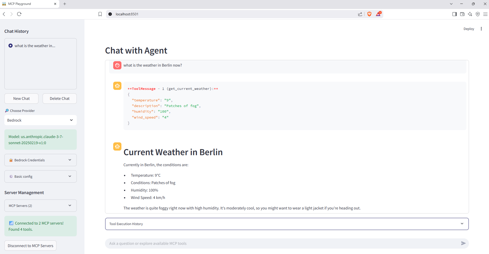
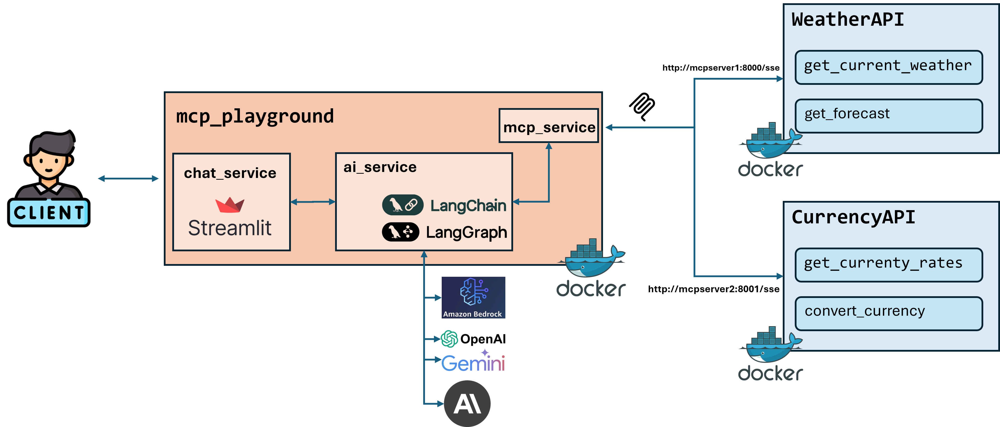

# MCP Playground 🛠️🌩️

A **Streamlit-based playground** that lets you chat with large language models and seamlessly plug in external **Multi-Server Command Protocol (MCP)** tools.  Spin up multiple FastMCP servers (Weather & Currency) alongside a Streamlit client, all orchestrated with Docker Compose.  The client is **provider-agnostic** (OpenAI • Amazon Bedrock • Anthropic • Google Gemini • Groq) thanks to LangChain + LangGraph. Built with **uv** for lightning-fast dependency installation.

## 📖 Learn More
Want a deep dive into how it all works? Check out the detailed walkthrough in this Medium article:
https://medium.com/@elkhan.alizada/your-own-ai-agent-playground-build-it-with-streamlit-langgraph-and-docker-4caeb6fe0ac4

---
## 🖥️🔌 Main Interface – Connected View


---
## 🏗️ Architecture


---

## ✨ Key Features

| Feature | Description                                                                                |
| ------- |--------------------------------------------------------------------------------------------|
| 🔌 **Multi-Server MCP** | Register any number of MCP servers; the agent auto-detects available tools & routes calls. |
| 🖥️ **Streamlit Chat UI** | Rich chat experience with history, sidebar controls and live tool execution output.        |
| 🧩 **Provider-Agnostic** | One LangChain interface for OpenAI, Bedrock, Anthropic, Google, Groq. Switch on the fly.   |
| 🎯 **Dynamic Model Selection** | Override default models with custom model IDs directly from the UI.                       |
| ➕ **Dynamic MCP Server Management** | Add/remove MCP servers on-the-fly through the UI without editing config files.    |
| 🤖 **React Agent via LangGraph** | `create_react_agent` enables dynamic tool selection and reasoning.                         |
| 🐳 **Docker-First** | Separate Dockerfiles for client & each server + a single `docker-compose.yaml`.            |
| 📦 **Extensible** | Drop-in new MCP servers or providers without touching UI code.                             |
---

## 📂 Project Layout

```text
mcp-playground/
├─ docker-compose.yaml          # One-command orchestration
├─ client/                      # Streamlit UI
│  ├─ app.py                    # Main entry-point
│  ├─ config.py                 # Typed settings & defaults
│  ├─ servers_config.json       # MCP endpoint catalogue
│  ├─ ui_components/            # Streamlit widgets
│  └─ ...
└─ servers/
   ├─ server1/                  # Weather Service MCP
   │  └─ main.py
   └─ server2/                  # Currency Exchange MCP
      └─ main.py
```

---

## 🚀 Quick Start

### 1 · Prerequisites

* [Docker ≥ 24](https://docs.docker.com/) & Docker Compose
* At least one LLM provider key (e.g. `OPENAI_API_KEY`) or AWS creds for Bedrock.

### 2 · Clone & Run

```bash
git clone https://github.com/your-org/mcp-playground.git
cd mcp-playground
docker compose up --build
```

**⚡ Fast Builds with uv**: All services use [uv](https://github.com/astral-sh/uv) for dependency management, providing significantly faster Docker builds compared to traditional pip. Dependencies are cached and only reinstalled when `pyproject.toml` changes.

| Service | URL | Default Port |
| ------- | --- | ------------ |
| Streamlit Client | <http://localhost:8501> | `8501` |
| Weather MCP | <http://localhost:8000> | `8000` |
| Currency MCP | <http://localhost:8001> | `8001` |
---

## ⚙️ Configuration

### Default Settings

All runtime settings are concentrated in **`client/config.py`** and environment variables.

| Variable | Purpose |
| -------- | ------- |
| `MODEL_ID` | Provider selector (`OpenAI`, `Bedrock`, `Anthropic`, `Google`, `Groq`).
| `TEMPERATURE` | Sampling temperature (sidebar slider). |
| `MAX_TOKENS` | Token limit (sidebar). |

**Default Model IDs:**
```python
MODEL_OPTIONS = {
    'OpenAI': 'gpt-4o',
    'Antropic': 'claude-3-5-sonnet-20240620',
    'Google': 'gemini-2.0-flash-001',
    'Bedrock': 'us.anthropic.claude-sonnet-4-5-20250929-v1:0',
    'Groq': 'meta-llama/llama-4-scout-17b-16e-instruct'
}
```

### 🎯 Dynamic Model Override

You can override the default model for any provider directly in the UI:

1. Select your provider from the dropdown
2. See the default model displayed
3. Enter a custom model ID in the **"🎯 Custom Model"** field
4. Leave empty to use the default

**Examples:**
- OpenAI: Override `gpt-4o` with `o1` for reasoning tasks or `gpt-4o-mini` for cost efficiency
- Anthropic: Use `claude-opus-4.6` or `claude-sonnet-4.6` for latest models
- Google: Try `gemini-2.0-flash-exp` or `gemini-exp-1206` for experimental features
- Bedrock: Use `us.anthropic.claude-opus-4-6-v1` for Opus 4.6 or `us.anthropic.claude-sonnet-4-6` for Sonnet 4.6
- Groq: Try different Llama models like `llama-3.3-70b-versatile`

### ➕ Dynamic MCP Server Management

Add custom MCP servers without editing `servers_config.json`:

1. Click **"➕ Add MCP Server"** expander in the sidebar
2. Fill in the server details:
   - **Server Name**: Unique identifier (e.g., `MyCustomServer`)
   - **Server URL**: Full endpoint URL (e.g., `http://localhost:8002/sse`)
   - **Transport Type**: `sse` or `http`
   - **Timeout**: Connection timeout in seconds (default: 600)
   - **SSE Read Timeout**: SSE-specific timeout (default: 900)
   - **Headers** (optional): JSON object with custom headers
     ```json
     {"Authorization": "Bearer token"}
     ```
3. Click **"Add Server"** to add multiple servers
4. Servers persist in your session until removed

**Server Sources:**
- **📄 From Config**: Static servers from `servers_config.json` (cannot be removed via UI)
- **📝 User Added**: Dynamic servers added through UI (can be removed with 🗑️ button)

MCP endpoints can also be statically defined in **`servers_config.json`** for persistent configuration.

---

## 💬 Using the Playground

1. **Select Provider** · Pick your LLM in the sidebar and paste the corresponding credentials.
2. **Customize Model (Optional)** · Override the default model ID with any model from your provider.
3. **Add MCP Servers (Optional)** · Add custom MCP servers through the UI or use the default servers.
4. **Connect MCP Servers** · Click connect; available tools appear in the *MCP Tools* list.
5. **Chat** · Type a question.
   * If connected, the React agent decides whether to call an MCP tool (e.g. *get_current_weather*).
   * Otherwise it falls back to plain LLM chat.
6. **Inspect Tool Calls** · Tool invocations are streamed back as YAML blocks with inputs & outputs.

> Try: `"What will the weather be in Baku tomorrow and how much is 100 USD in AZN?"`

---

## 🛠️ Included MCP Servers

### Weather Service `:8000`

```python
mcp = FastMCP("Weather Service", host="0.0.0.0", port=8000)

@mcp.tool()
async def get_current_weather(location: str) -> dict: ...

@mcp.tool()
async def get_forecast(location: str, days: int = 3) -> dict: ...
```

### Currency Exchange `:8001`

```python
mcp = FastMCP("Currency Exchange", host="0.0.0.0", port=8001)

@mcp.tool()
async def get_currency_rates(date: str = None) -> dict: ...

@mcp.tool()
async def convert_currency(amount: float, from_currency: str, to_currency: str, date: str = None) -> dict: ...
```
---

## 🙏 Acknowledgements

* [LangChain](https://github.com/langchain-ai/langchain)  
* [LangGraph](https://github.com/langchain-ai/langgraph)  
* [FastMCP](https://github.com/langchain-ai/fastmcp)  
* [Streamlit](https://streamlit.io/)  

---

